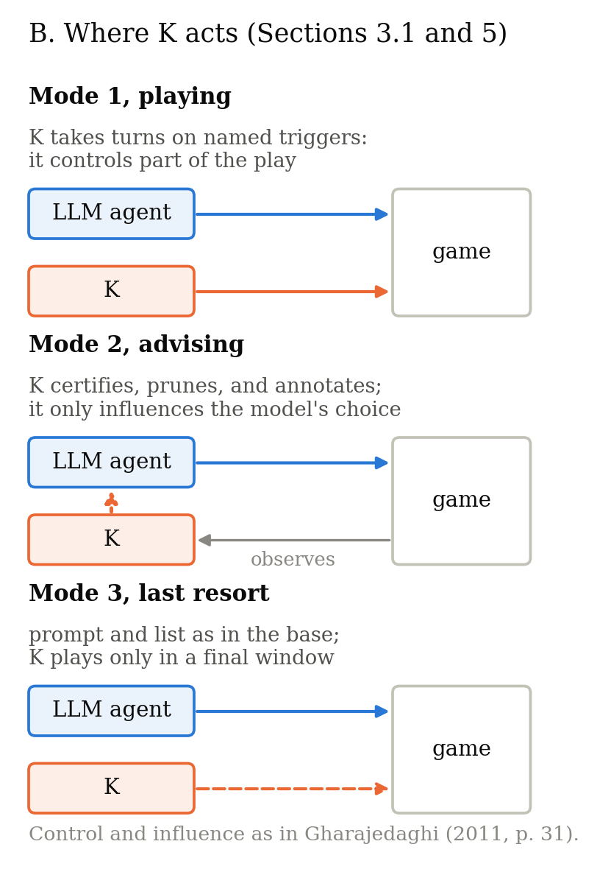

[English](README.md) · Português (Brasil)

# Certificando a ausência de efeito e identificando a condição de vitória sob pontuação por ação no ARC-AGI-3

Código e materiais da nossa submissão ao [ARC Prize 2026 Paper Track](https://arcprize.org/competitions/arc-prize-2026) (ARC-AGI-3).

| | |
|---|---|
| Artigo (PDF) | [`paper/`](paper/) (inglês, versão de registro; tradução para o português do Brasil ao lado) |
| Writeup do Kaggle | público quando o Paper Track fechar (9 de novembro de 2026) |
| Notebook público (entrada elegível, ref. 57852519) | [What Exploration Can Ignore: Duck fork, K playing](https://www.kaggle.com/code/hralmjc/what-exploration-can-ignore-duck-fork-k-playing) |
| Os três modos sobre a base dfranzen | [controle](https://www.kaggle.com/code/hralmjc/what-exploration-can-ignore-dfranzen-control), [K jogando](https://www.kaggle.com/code/hralmjc/what-exploration-can-ignore-dfranzen-k-playing), [K aconselhando](https://www.kaggle.com/code/hralmjc/what-exploration-can-ignore-dfranzen-k-advising), [último recurso](https://www.kaggle.com/code/hralmjc/what-exploration-can-ignore-dfranzen-last-resort) |
| Página do projeto (como o trabalho foi feito) | [docs/](docs/index.pt-BR.md) |

Tudo o que o artigo cita está neste repositório: o artigo, os cinco notebooks com os seus metadados e módulos, o código do
agente, a bancada, os testes, as figuras e os arquivos por trás de cada rodada da fase A. Um clone substitui a volta pelas
páginas do Kaggle.


## O que o artigo defende

O ARC-AGI-3 pede aos agentes que definam objetivos sem instruções, mas todo jogo já fixa a sua condição de vitória, e a
pontuação mede com que economia ela é alcançada. O que um agente pode fazer, então, é identificar o objetivo que o jogo
fixou, e não escolher um, sem gastar as ações que a pontuação cobra. Construímos o nosso agente para medir esse passo, e
a medida voltou, na maior parte, negativa: em 50 de 66 vitórias locais, o explorador venceu sem que o identificador
nomeasse o objetivo.

O agente acopla um explorador baseado em grafo (K) ao *harness* de um agente de grande modelo de linguagem (LLM) de pesos
abertos. O explorador emite *certificados revogáveis de ausência de efeito* para ações observadas não mudarem nada num
estado, detecta estado oculto quando um certificado falha ou uma ação segura mata, e ordena hipóteses de objetivo (H5)
que apenas ordenam as ações candidatas. Como o LLM é a política padrão do agente, tratamos essa camada como instrumento
de medida e variamos o modo como ela está presente: jogando, aconselhando ou agindo só como último recurso. Nenhum modo
produziu ganho mensurável de pontuação em dois lotes da fase A, e o artigo relata cada comparação com o que ela pode e
não pode estabelecer.



*Figura 2B do artigo: K controla parte do jogo quando joga e como último recurso, e apenas influencia o modelo quando aconselha.*

## Organização do repositório

| pasta | conteúdo | artigo |
|---|---|---|
| `paper/` | o PDF (inglês, versão de registro) e a tradução para o português do Brasil | — |
| `notebooks/` | os cinco notebooks do Kaggle (código e texto, sem saídas), os seus metadados de kernel e os módulos que eles escrevem, com os nomes de identificadores deste repositório | §§5, 10, Tabela 3 |
| `agent/` | o explorador K, os certificados de ausência de efeito e os gatilhos de estado oculto (H8), o componente de hipóteses de objetivo (H5) e a memória entre jogos | §§3.1–3.4 |
| `bench/` | a bancada local offline (25 jogos públicos, 4 sementes, 1.500 passos) com as flags dos oito braços de atribuição, e as oito execuções da Tabela 4; `results/phase-a/` guarda os arquivos por trás de cada rodada da fase A (log do kernel, resumo, registro do benchmark) e `phase_a.py` recompõe a partir deles, ou de uma nova rodada no Kaggle, as conferências de validade e as Tabelas 1 e 3 | §5, Tabelas 1, 3 e 4, Figuras 1 e 2 |
| `tests/` | a suíte de testes e os mutantes do protocolo de verificação adversarial | §4 |
| `manifests/` | manifestos SHA-256 dos artefatos congelados citados no artigo | §§5, 10 |
| `figures/` | os scripts que geram as quatro figuras (as Figuras 1 e 2 são diagramas; a Figura 3 tem dois painéis, um por lote da fase A), e as figuras | §§1, 3.2, 5 |
| `docs/` | uma página do projeto (GitHub Pages) com um relato de como o trabalho foi feito | — |

## Reproduzindo os resultados

Tudo aqui roda numa CPU, offline, sem modelo de linguagem. Testamos no Linux com Python 3.14.7. Os tempos locais abaixo
vêm de um mini PC com um AMD Ryzen 5 5500U (seis núcleos), 32 GB de RAM e sem GPU dedicada. Execute os comandos a partir
da raiz deste repositório. No Windows, use o WSL (Windows Subsystem for Linux), onde valem os mesmos comandos; não
testamos uma instalação nativa no Windows.

| script | reproduz | precisa de | tempo |
|---|---|---|---|
| `bench/table4.py` | a Tabela 4, a partir das execuções incluídas | só Python | segundos |
| `bench/bench.py` | um braço da bancada do zero (passo 3) | ambiente, jogos | 13–37 min por braço |
| `figures/make_diagrams.py` | as Figuras 1 e 2 (diagramas) | matplotlib | segundos |
| `figures/make_figures.py` | as Figuras 3 e 4 | matplotlib | segundos |
| `tests/test_*.py`, `tests/mutants.py` | os testes e mutantes do protocolo (passo 4) | ambiente, pacote TAAF | ~5 min, ~40 min |
| `bench/phase_a.py` | as Tabelas 1 e 3, a partir das execuções do Kaggle incluídas ou de uma execução sua (passo 6) | só Python | segundos |

Os passos 3 a 6 são independentes; cada um precisa só dos passos que cita.

### 1. Ambiente

Clone o starter oficial e o repositório de agentes nos commits que usamos, e crie o ambiente:

```bash
git clone https://github.com/arcprize/ARC-AGI-3-Kaggle-Starter.git
git -C ARC-AGI-3-Kaggle-Starter checkout eeb1535404f321d280a8f9194bbc1d7aca5f05fc
git clone https://github.com/arcprize/ARC-AGI-3-Agents.git ARC-AGI-3-Kaggle-Starter/vendor/ARC-AGI-3-Agents
git -C ARC-AGI-3-Kaggle-Starter/vendor/ARC-AGI-3-Agents checkout 4743e7d0aaae0ded0d98a89a7e282e63564cd58b
python3.14 -m venv ARC-AGI-3-Kaggle-Starter/.venv
ARC-AGI-3-Kaggle-Starter/.venv/bin/pip install --no-deps -r requirements.txt
```

### 2. Jogos

Baixe os 25 jogos públicos uma vez para `ARC-AGI-3-Kaggle-Starter/environment_files/` com o toolkit: crie
`arc_agi.Arcade(operation_mode=OperationMode.NORMAL, environments_dir="environment_files")` e chame `make()` em cada jogo
listado por `get_environments()`. Uma [chave da API do ARC](https://arcprize.org/), gratuita, dá o conjunto público
completo. As nossas execuções usaram as versões baixadas em 30 de setembro de 2026 (por exemplo, `ls20-9607627b` e
`vc33-5430563c`).

### 3. Tabela 4 e Figura 4

Recalcule-as a partir das execuções incluídas. Leva segundos:

```bash
python3 bench/table4.py
ARC-AGI-3-Kaggle-Starter/.venv/bin/python figures/make_figures.py   # escreve aqui os PDFs das Figuras 3 e 4
ARC-AGI-3-Kaggle-Starter/.venv/bin/python figures/make_diagrams.py   # e os das Figuras 1 e 2
```

Para reexecutar um braço (13 a 37 minutos cada), escolha um dos oito braços em [`bench/README.md`](bench/README.md):

```bash
cd ARC-AGI-3-Kaggle-Starter
BENCH_ARM=default .venv/bin/python ../bench/bench.py --agents k --max-steps 1500 --seeds 4 --quiet
```

### 4. Testes e mutantes

Os testes precisam também do pacote de fontes TAAF sobre o qual rodam o *harness* Duck e a base dfranzen. Baixe o
dataset público do Kaggle [`jeroencottaar/taaf-kaggle-source-share`](https://www.kaggle.com/datasets/jeroencottaar/taaf-kaggle-source-share)
(pacote criado em 12 de junho de 2026, com `tufa-arc-agi-framework` em `fe9f7c4` e `ARC3-Inference` em `aa69123`),
descompacte-o de modo que `src/` fique dentro dele, e execute:

```bash
export ARC_STARTER=$PWD/ARC-AGI-3-Kaggle-Starter TAAF_SOURCE=/path/to/taaf-kaggle-source-share
for f in tests/test_*.py; do ARC-AGI-3-Kaggle-Starter/.venv/bin/python "$f" || echo "FAILED: $f"; done   # ~5 min, 92 testes
ARC-AGI-3-Kaggle-Starter/.venv/bin/python tests/mutants.py                                              # ~40 min, 85 mutantes
```

### 5. Integridade

Execute `sha256sum -c manifests/SHA256SUMS` para conferir este repositório. Os digests dos notebooks e dos módulos
submetidos estão em [`manifests/frozen-artifacts.tsv`](manifests/frozen-artifacts.tsv); cada pasta de
[`notebooks/`](notebooks/) tem o seu próprio `SHA256SUMS` para as cópias mantidas aqui.

### 6. Fase A no Kaggle

As rodadas da Tabela 3 (segundo lote, 7 de novembro de 2026) foram produzidas pelos quatro notebooks públicos listados
acima, executados no Kaggle com o mesmo código congelado, três rodadas por modo e quatro para o controle. Os arquivos de
que cada número foi lido estão em [`bench/results/phase-a/`](bench/results/phase-a/), uma pasta por rodada, com o primeiro
lote, as rodadas da linha Duck da Tabela 1 e a execução da v14.1 ao lado; `rounds.tsv` diz quais rodadas o artigo leu. O
Kaggle montou as entradas dos notebooks em dois leiautes diferentes para kernels diferentes deste conjunto. Os notebooks
resolvem os dois e registram qual deles encontraram; as três tentativas que não partiram sob o leiaute antigo também
estão incluídas.

```bash
python3 bench/phase_a.py                 # validade de cada rodada, Tabela 3, Tabela 1, resumos por lote (segundos)
```

Para rodar você mesmo um notebook, copie-o de [`notebooks/`](notebooks/) para o Kaggle com as entradas e o acelerador
indicados no seu `kernel-metadata.json`, baixe a saída (`kaggle kernels output <user>/<slug> -p <folder>`) e execute
`python3 bench/phase_a.py <folder>`: ele imprime as mesmas conferências de validade e os mesmos contadores para a sua
execução.

## Construído sobre

- O *harness* Duck da Tufa Labs (Bessis et al., 2026a), licença MIT, do [pacote de fontes TAAF](https://www.kaggle.com/datasets/jeroencottaar/taaf-kaggle-source-share): [notebook no Kaggle](https://www.kaggle.com/code/jeroencottaar/tufa-labs-duck-harness-june-30-milestone-winner), [repositório no GitHub](https://github.com/Tufalabs/duck-harness), [relato técnico](https://www.kaggle.com/competitions/arc-prize-2026-arc-agi-3/discussion/717133).
- O notebook dfranzen do Milestone 2 do ARC-AGI-3 (Franzen, 2026a), licença Apache-2.0: [notebook no Kaggle](https://www.kaggle.com/code/dfranzen/arc-agi-3-milestone-2-solution), [repositório no GitHub](https://github.com/da-fr/arc-agi-3-solution), [relato técnico](https://www.kaggle.com/writeups/dfranzen/arc-agi-3-milestone-2).
- O toolkit e os materiais da competição ARC-AGI-3 (ARC Prize Foundation, 2026): o [starter](https://github.com/arcprize/ARC-AGI-3-Kaggle-Starter) e o [repositório de agentes](https://github.com/arcprize/ARC-AGI-3-Agents).

As referências completas estão no artigo.

## Como este trabalho foi feito

Um relato mais longo, com o tempo que levou, o que deu errado e o que aprendemos, está na [página do projeto](docs/index.pt-BR.md).
Este trabalho foi realizado com agentes de grandes modelos de linguagem de provedores diferentes, usados deliberadamente
sob um protocolo fixo: pré-registro, um *blue team* antes de todo *red team*, *red teams* por outros modelos, testes de
regressão e mutantes para cada defeito, e leitura integral de uma fonte antes de citá-la. Toda saída foi adjudicada pelo
autor, que executou todos os experimentos no Kaggle e assume a responsabilidade pelo conteúdo. Nenhum modelo de linguagem
é autor. A declaração completa está no artigo.

## Citação

Veja [`CITATION.cff`](CITATION.cff).

## Licença

Apache License 2.0 (veja [`LICENSE`](LICENSE)). Os componentes de terceiros mantêm as suas licenças, listadas em
[`NOTICE`](NOTICE).
