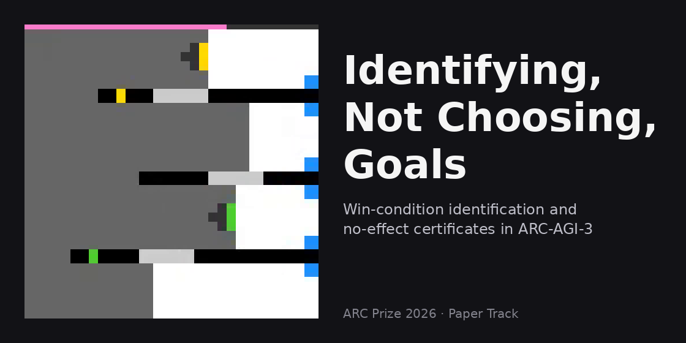
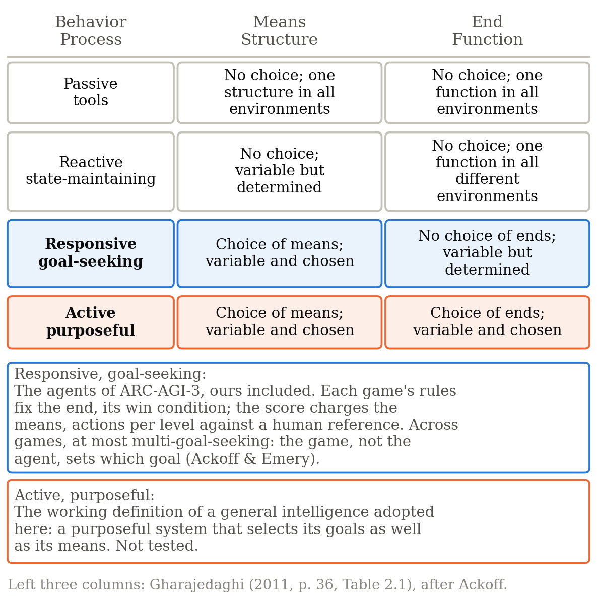
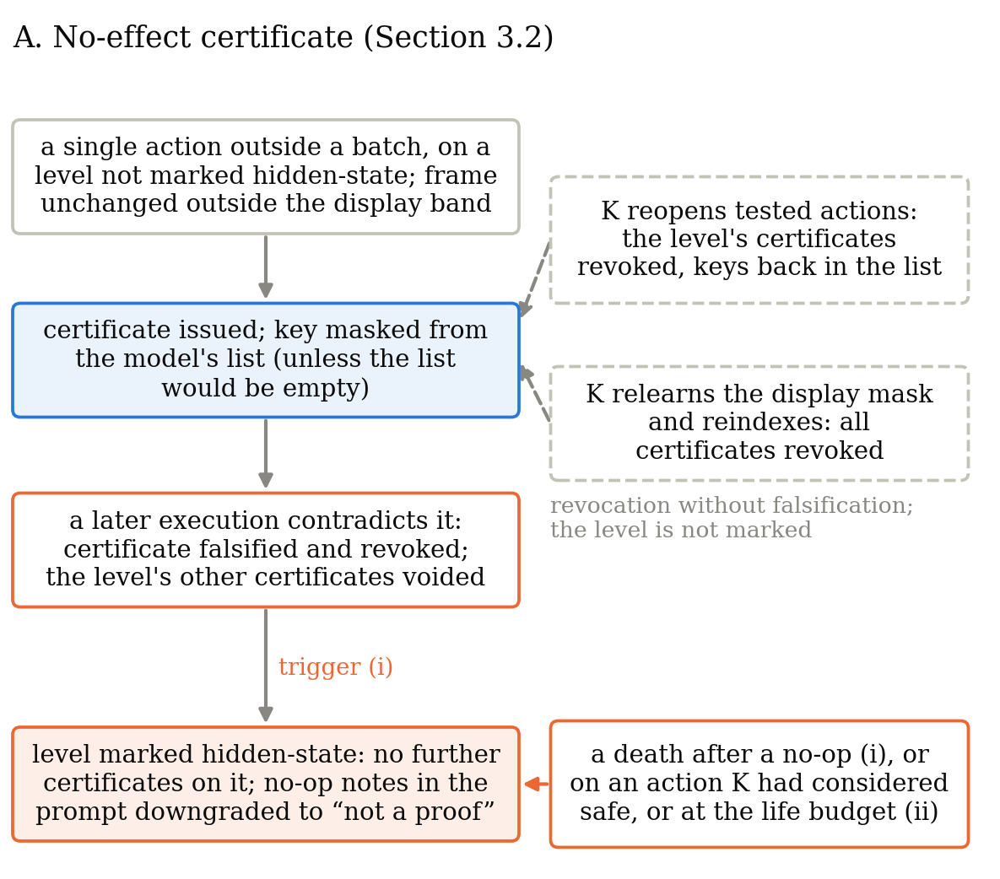
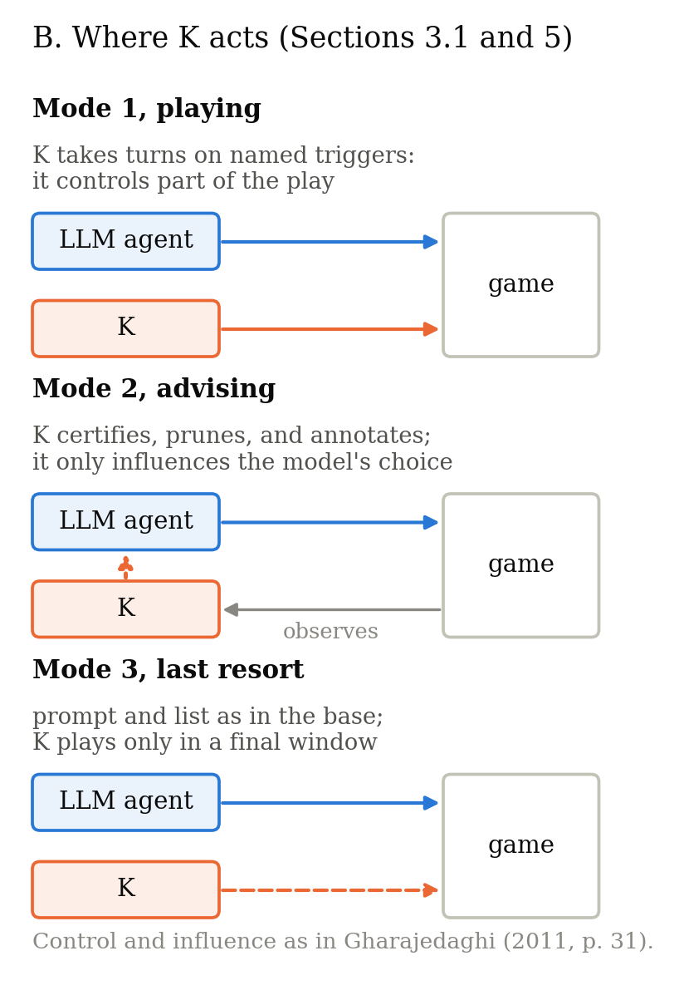

English · [Português (Brasil)](./index.pt-BR.html)

# Certifying No Effect and Identifying the Win Condition Under Per-Action Scoring in ARC-AGI-3

*ARC Prize 2026 · Paper Track · how the work was done, by the author*



- Paper (PDF): [`paper/`](https://github.com/hralm/arc-agi-3-paper-track-2026/tree/main/paper), added at submission on 8 November 2026 and revised until the deadline on 9 November
- Code, bench, tests, manifests, the five notebooks and the files behind every phase-A round: [this repository](https://github.com/hralm/arc-agi-3-paper-track-2026) (`notebooks/`, `bench/results/phase-a/`, `bench/phase_a.py`)
- Notebooks: the [eligible entry](https://www.kaggle.com/code/hralmjc/what-exploration-can-ignore-duck-fork-k-playing) (Duck fork, K playing) and the four on the dfranzen base: [control](https://www.kaggle.com/code/hralmjc/what-exploration-can-ignore-dfranzen-control), [K playing](https://www.kaggle.com/code/hralmjc/what-exploration-can-ignore-dfranzen-k-playing), [K advising](https://www.kaggle.com/code/hralmjc/what-exploration-can-ignore-dfranzen-k-advising), [last resort](https://www.kaggle.com/code/hralmjc/what-exploration-can-ignore-dfranzen-last-resort)

## The question I started from

[ARC-AGI-3](https://doi.org/10.48550/arXiv.2603.24621) says it evaluates goal-setting. But every game already has a win condition, and the score charges every
action you take. So what can an agent do here? It can identify the goal the game has set, and not choose one. I wanted
to know whether that step, *identifying the win condition*, can be done without spending the actions the score counts,
and whether it reaches the score at all.

The question came from two readings outside the benchmark's lineage. For the foundation, goal-setting is identifying
desirable future states without instructions, and intelligence is efficiency across its four components (exploration,
modeling, goal-setting, and planning and execution). Two systems thinkers, Ackoff and Emery ([*On Purposeful Systems*](https://doi.org/10.4324/9781315125640), 1972),
order systems by who chooses the goal. The biologist Humberto Maturana, with Guiloff ([“The quest for the intelligence of
intelligence,”](https://doi.org/10.1016/0140-1750(80)90006-8) 1980), places the goal in the description an observer makes of a system, not in the system's own workings.

Read together, the two made me look at where the goal sits in ARC-AGI-3: in each game's hidden rules, which fix the win
condition of every level. The score, [Relative Human Action Efficiency (RHAE)](https://docs.arcprize.org/methodology), is not one of those rules. It is computed
from outside, comparing the agent's actions per level with those of human players, and it measures how economically each
win condition is reached, not which goal was chosen.



**Figure 1 of the paper.** In the classification that Gharajedaghi draws from Ackoff (*Systems Thinking*, 2011, p. 36), a
goal-seeking system chooses its means and not its ends, and a purposeful one chooses both. The score charges the means.

That became the axis of the research: inside a game, setting a goal is identifying what the rules already determine, and
the score does not see that step on its own. It soon became evident how hard it would be to score competitively down that
path, since every action spent on identifying is charged. Even so, every submission and every test was designed to answer
the hypothesis, not to climb the leaderboard.

To measure it I built a graph explorer (K), a program that maps a game by trying actions and remembering what each one
changed. It issues no-effect certificates, written and revocable notes that an action changed nothing in a given state;
it flags hidden state, the game changing something the screen did not show, when a certificate fails or a safe action
kills; and it ranks goal hypotheses, guesses about what wins, which only order the candidate actions. Then I put it
inside the harness of an open-weight language model agent, the program that runs the model and plays its moves, in three
ways: playing, advising, and as a last resort. The paper is the account of what that layer claimed, what use I could observe, and what
the score comparisons can and cannot establish. Most of what they establish is negative, and that is the result: in 50 of
66 local wins the explorer won without the identifier naming the goal, and no mode produced a measurable score gain.





**Figure 2 of the paper.** Above, the life of a certificate: a contradiction or an unexpected death marks the level as
hidden state, and no certificate is issued there afterwards. Below, the three modes: K controls part of the play when
playing and as a last resort, and only influences the model when advising, in Gharajedaghi's sense of control and influence.

## Time, machine, and budget

Six weeks, from 29 September to 8 November 2026. One author, with language model agents doing the executive work (code,
tests, benches, drafts) under rules I set and reviewed, as the paper's Disclosure states.

My machine is a consumer mini PC without a discrete GPU: an AMD Ryzen 5 5500U with six cores, 32 GB of RAM, and
the processor's own graphics. That one fact shaped the project. Everything that needed a GPU ran inside [Kaggle](https://www.kaggle.com/competitions/arc-prize-2026-arc-agi-3)'s weekly
quota, so every phase-A round competed with every other for the same 30 hours, and the local
bench had to be something a CPU could finish overnight: 25 public games, 4 seeds (random starts), 1,500 steps, about 35 minutes per arm.
I presumed that most leading entries adapted the model itself, with hardware beyond the Kaggle allotment. I could not
test that, and I did not try to. The [public first place](https://www.kaggle.com/competitions/arc-prize-2026-arc-agi-3/discussion/755795) later confirmed it: compression of the model, a private
serving stack, and reinforcement learning on eight B200 GPUs for the hard stages, which lowered action efficiency, so its
final run kept the base model for six hours and switched for the last three. I went through the explorer, which trains
nothing; that entry went through the model and its serving, which need that hardware. The question I could test was
narrower: does a layer that *knows things about the game* help the model that plays it?

## How the work was organized

The coupled agent went through two lines. The Duck line (v1 to v7) sits on [Tufa Labs' harness](https://www.kaggle.com/code/jeroencottaar/tufa-labs-duck-harness-june-30-milestone-winner), and its v5 is the eligible
entry. The dfranzen line (v8 to v14.1) sits on the open [Milestone 2 notebook](https://www.kaggle.com/code/dfranzen/arc-agi-3-milestone-2-solution). Its last version finished the hidden-set
rerun after the deadline and is reported as a measurement only.

The protocol the paper describes was not there on the first day. Its rules came one at a time, each after a finding that
showed what the earlier rules did not cover. The next section follows that order.

## How the method changed with each finding

- **The distance to the leading entries showed that the model-free line would not hold under the competition's
  conditions.** The explorer closed levels on the public games, but its score sat far below the entries at the top, which
  ran a language model. I then proposed coupling one of the best public notebooks and replacing, in what was theirs, with
  our contribution, treating the explorer as a measuring instrument and not as the player. Next I suggested changes to the
  harness so that it would talk better with the explorer; with no time to rebuild it, what remained were the point
  adjustments of triggers and caps. The evidence pointed to the whole set, model, harness, and explorer, needing to be
  readjusted to yield the efficiency gain. That was the direction the leading entries had taken, adapting the model and
  its serving. I had noticed it before the deadline, and their [post-competition thread](https://www.kaggle.com/competitions/arc-prize-2026-arc-agi-3/discussion/755202) and [writeups](https://www.kaggle.com/competitions/arc-prize-2026-arc-agi-3/writeups/more-tokens-from-public-nb-to-lb-161th-missed-4) corroborated the
  impression.
- **The first coupled version came with a pre-registration.** Before the first version of the Duck line, on 27 October, I
  wrote the invariants, the claims, and the conditions that would falsify them. From then on one model built each version
  and its tests, and a different model, in a fresh session, attacked the frozen artifact against its hash manifest and
  returned a verdict with a reproducible proof for each finding. Every defect came back with a regression test and a
  mutant, a deliberate reintroduction of the defect that the new test has to catch. By v14.1 that was 92 tests and 85
  mutants, and I did not submit any version with an open blocking finding.
- **An inference I did not want to make put the counters in the log.** In the v4 rounds the trigger that marked a level as
  hidden state was not printed, and the paper infers it from what is absent. From v11 on, each trigger has its own counter
  in the run's summary.
- **The first scored submission, at 0.75, led to the modes that cap the intervention.** K took most of the model's turns,
  and the score charges every one of them. I kept the number in the paper as evidence compatible with the explorer's action
  cost, and the next configurations left the turn with the model: advising, where K certifies, prunes, and annotates but
  never plays, and last resort, where prompt and action list are byte-identical to the unmodified base until the final 600
  seconds of a game. The cap limits the intervention, and not the loss.
- **One pilot round fixed the reading rule.** After a first round of the base and of the advisor, and before the rest, it
  was written that an arm shows an effect only if its mean differs from the base's by more than twice the larger sample SD
  of the pair (the spread of its scores), and that whether a round is read is decided before its result, in both directions. A control round that had
  to rerun because the notebooks' text changed was read, since the batch was still open. A last-resort round with nine
  exceptions from my layer was excluded and replaced, by the rule written days earlier.
- **Two batches of the same base, 23 points apart, closed every comparison inside its batch.** The base scored 74.91 in the
  first batch and 52.30 in the second, five days later, on the same base, games, and caps. Since then no number crosses
  batches, and in the second batch the control ran on the same day as the arms. [Another team](https://www.kaggle.com/competitions/arc-prize-2026-arc-agi-3/writeups/15th-public-tokens-are-progress-serving-enginee) later saw its identical
  code score between 43.18 and 53.27 across runs, a spread of 10.1 points.

Two rules ran through all of it: a source was read in full before being cited, and the final text was revised block by
block, fidelity to the sources first, style second.

## What went wrong

- **The model server took 305 to 1,494 seconds to load,** and in four of eight runs the games were released while it was
  still loading. One control round was lost because the server never came up. It was rerun.
- **The last submission did not have its rerun budget.** v14.1 went in on 2 November at 22:30 UTC, before the deadline.
  Its nine-hour rerun, the organizer's own run of the notebook on games I never
  see, ended after it, and only a scored submission can be selected. [Another team on the same base](https://www.kaggle.com/competitions/arc-prize-2026-arc-agi-3/writeups/more-tokens-from-public-nb-to-lb-161th-missed-4) reports
  the same miss.
- **Kaggle mounted the notebooks' inputs under two different layouts.** Three pushes of one notebook died before any game
  ran. The public notebooks now resolve both layouts and record which one they found.
- **In the one game I diagnosed, the model never mentioned the advisor's notes** in its visible reasoning. Its costly moves
  came from a code loop it wrote itself, which bypassed the pruned action list. That trace does not let me blame the layer
  for the gap, and it does not let me clear it either.

## What I learned

- **Deciding before the number is what makes a negative result worth publishing.** What counts as a round, how an effect is
  read, which arm is descriptive: all of it was written before the data arrived, and that is why I can report 0.75 and
  50 of 66 without flinching.
- **Three public games and three rounds detect only large effects.** On the same day, with the same unmodified notebook,
  one game scored from 21 to 100. With sample SDs above 15 the bar was about 45 points, and no arm came near it.
- **A complete submission is a finished run, not a record.** [The rules](https://www.kaggle.com/competitions/arc-prize-2026-arc-agi-3/overview) fix the deadline and the nine-hour cap, and not
  that the rerun must have finished. What counts as delivered in time is not the record of the submission, which was in
  time, but the end of its run, with its result. The arithmetic follows: a last submission needs the full rerun time plus
  queue margin before the deadline.
- **Red teams, other models set to attack the code, found one class of defect again and again.** They were not failures of the search, which
  simply did not find the way. They were places where the agent asserted one thing, in its prompt text or in its plan, and
  the game permitted another: an action outside the legal list on a revisited state, a certificate that survived the
  agent's death, a plan that crossed a level boundary inside one batch, a life counter inherited from one level into the
  next. The paper turns that list into a checklist for harness work: legality at revisits, death as falsification, batch
  boundaries, merged-state provenance, and advisory honesty.
- **The explorer wins by search, and the identifier mostly misses.** If goal-setting is to be scored as a component of
  intelligence, the benchmark would have to ask the agent to state the win condition it pursues and score that statement
  apart from action efficiency. Choosing goals, rather than identifying the one a game has set, lies further still, and I
  did not test it. A [seventh-placed team](https://www.kaggle.com/competitions/arc-prize-2026-arc-agi-3/writeups/public-lb-7-short-overview) measured the same gap from the other side: given the written rules of each
  public game and a hint per level, its model scored 85.7 instead of 64.4, and most of the gap was in working the rules out.

## Disclosure

Large language model agents from different providers and of different profiles, Western and Eastern, were used
deliberately under a fixed protocol. I set the questions, the hypotheses, and the working rules. The agents implemented
the code, ran the local tests, and drafted the text. I adjudicated every output, ran every Kaggle experiment, and take
responsibility for the content. No language model is an author. The full statement is in the paper.

## How to cite

The paper is the version of record. In text:

> de Souza, J. C. S. (2026). *Certifying no effect and identifying the win condition under per-action scoring in ARC-AGI-3*.
> ARC Prize 2026 Paper Track. https://github.com/hralm/arc-agi-3-paper-track-2026

To cite this page:

> de Souza, J. C. S. (2026, November 8). *How the work was done* [Project page]. https://hralm.github.io/arc-agi-3-paper-track-2026/

```bibtex
@misc{deSouza2026certifying,
  author = {de Souza, Julio Cesar Silveira},
  title  = {Certifying No Effect and Identifying the Win Condition Under Per-Action Scoring in ARC-AGI-3},
  year   = {2026},
  note   = {ARC Prize 2026 Paper Track},
  url    = {https://github.com/hralm/arc-agi-3-paper-track-2026}
}
```

## License

The text of this page is released under the [Creative Commons Attribution 4.0 International license (CC BY 4.0)](https://creativecommons.org/licenses/by/4.0/).
The code in the [repository](https://github.com/hralm/arc-agi-3-paper-track-2026) is under the Apache License 2.0; third-party components keep their licenses, listed in its `NOTICE`.
