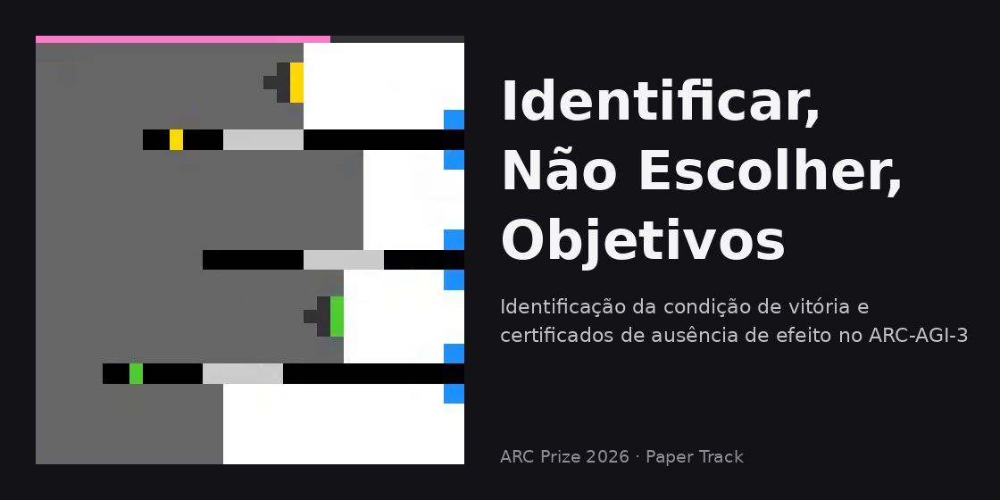

[English](./) · Português (Brasil)

# Certificando a ausência de efeito e identificando a condição de vitória sob pontuação por ação no ARC-AGI-3

*ARC Prize 2026 · Paper Track · como o trabalho foi feito, pelo autor*



- Artigo (PDF): [`paper/`](https://github.com/hralm/arc-agi-3-paper-track-2026/tree/main/paper), acrescentado na submissão, em 8 de novembro de 2026
- Código, bancada, testes, manifestos, os cinco notebooks e os arquivos por trás de cada rodada da fase A: [este repositório](https://github.com/hralm/arc-agi-3-paper-track-2026) (`notebooks/`, `bench/results/phase-a/`, `bench/phase_a.py`)
- Notebooks: a [entrada elegível](https://www.kaggle.com/code/hralmjc/what-exploration-can-ignore-duck-fork-k-playing) (*fork* do Duck, K jogando) e os quatro sobre a base dfranzen: [controle](https://www.kaggle.com/code/hralmjc/what-exploration-can-ignore-dfranzen-control), [K jogando](https://www.kaggle.com/code/hralmjc/what-exploration-can-ignore-dfranzen-k-playing), [K aconselhando](https://www.kaggle.com/code/hralmjc/what-exploration-can-ignore-dfranzen-k-advising), [último recurso](https://www.kaggle.com/code/hralmjc/what-exploration-can-ignore-dfranzen-last-resort)

## A pergunta da qual parti

O [ARC-AGI-3](https://doi.org/10.48550/arXiv.2603.24621) diz avaliar a definição de objetivos. Mas todo jogo já tem uma condição de vitória, e a pontuação cobra cada
ação que você toma. Então, o que um agente pode fazer aqui? Pode identificar o objetivo que o jogo fixou, e não escolher
um. Eu queria saber se esse passo, *identificar a condição de vitória*, pode ser dado sem gastar as ações que a pontuação
conta, e se ele chega sequer a alcançar a pontuação.

A pergunta veio de duas leituras fora da linhagem do benchmark. Para a fundação, a definição de objetivos é identificar
estados futuros desejáveis sem instruções, e a inteligência é eficiência nos seus quatro componentes (exploração,
planejamento e execução, definição de objetivos e modelagem). Dois pensadores sistêmicos, Ackoff e Emery ([*On Purposeful
Systems*](https://doi.org/10.4324/9781315125640), 1972), ordenam os sistemas por quem escolhe o objetivo. O biólogo Humberto Maturana, com Guiloff ([«The quest
for the intelligence of intelligence»](https://doi.org/10.1016/0140-1750(80)90006-8), 1980), põe o objetivo na descrição que um observador faz de um sistema, não no
funcionamento do próprio sistema.

Lidas juntas, as duas me fizeram olhar para onde o objetivo está no ARC-AGI-3: nas regras ocultas de cada jogo, que fixam
a condição de vitória de cada nível. A pontuação, a [eficiência relativa de ações humanas (RHAE)](https://docs.arcprize.org/methodology), não é uma dessas regras.
Ela é calculada de fora, comparando as ações do agente por nível com as de jogadores humanos, e mede com que economia cada
condição de vitória é alcançada, não qual objetivo foi escolhido.

Esse passou a ser o eixo da pesquisa: dentro de um jogo, definir um objetivo é identificar o que as regras já determinam, e
a pontuação não vê esse passo em separado. Logo começou a ficar evidente a dificuldade de pontuar competitivamente por esse
caminho, porque cada ação gasta em identificar é cobrada. Mesmo assim, cada envio e cada teste foram desenhados para
responder à hipótese, e não para subir no *leaderboard*.

Para medi-lo, construí um explorador de grafo (K), um programa que mapeia um jogo tentando ações e lembrando o que cada
uma mudou. Ele emite certificados de ausência de efeito, anotações escritas e revogáveis de que uma ação não mudou nada
num dado estado; sinaliza estado oculto, o jogo ter mudado algo que a tela não mostrou, quando um certificado falha ou
uma ação segura mata; e ordena hipóteses de objetivo, palpites sobre o que vence, que apenas ordenam as ações
candidatas. Depois o pus dentro do *harness* de um agente de modelo de linguagem de pesos abertos, o programa que roda o
modelo e executa as jogadas dele, de três maneiras: jogando, aconselhando e como último recurso. O artigo é o relato do que essa camada afirmou, do
uso que pude observar e do que as comparações de pontuação podem e não podem estabelecer. A maior parte do que elas
estabelecem é negativa, e esse é o resultado: em 50 de 66 vitórias locais o explorador venceu sem que o identificador
nomeasse o objetivo, e nenhum modo produziu ganho mensurável de pontuação.

## Tempo, máquina e orçamento

Seis semanas, de 29 de setembro a 8 de novembro de 2026. O autor supervisiona o trabalho executivo realizado por agentes de
modelos de linguagem (código, testes, bancadas e rascunhos), sob regras que defini e revisei, conforme a Declaração do
artigo.

Minha máquina é um mini PC doméstico, sem GPU dedicada: um AMD Ryzen 5 5500U de seis núcleos, 32 GB de RAM e os gráficos
integrados ao processador. Esse fato, sozinho, moldou o projeto. Tudo o que precisava de GPU rodou dentro da cota semanal
do [Kaggle](https://www.kaggle.com/competitions/arc-prize-2026-arc-agi-3), de modo que cada rodada da fase A disputou com todas as outras as mesmas
30 horas, e a bancada local tinha de ser algo que uma CPU terminasse de um dia para o outro: 25 jogos públicos,
4 sementes (partidas aleatórias), 1.500 passos, cerca de 35 minutos por braço. Presumi que a maioria das entradas de ponta adaptou o
próprio modelo, com hardware além do que o Kaggle concede. Não pude testar isso, e não tentei. O [primeiro lugar
público](https://www.kaggle.com/competitions/arc-prize-2026-arc-agi-3/discussion/755795) confirmou depois: compressão do modelo, uma pilha privada de *serving* e aprendizado por reforço em oito GPUs
B200 para os estágios difíceis, o que reduziu a eficiência de ações, de modo que a rodada final manteve o modelo base por
seis horas e trocou nas três finais. Eu segui pelo explorador, que não treina nada; aquela entrada seguiu pelo modelo e
pelo seu *serving*, que precisam desse hardware. A pergunta que eu podia testar era mais estreita: uma camada que *sabe
coisas sobre o jogo* ajuda o modelo que o joga?

## Como o trabalho foi organizado

O agente acoplado passou por duas linhas. A linha Duck (v1 a v7) roda sobre o [*harness* da Tufa Labs](https://www.kaggle.com/code/jeroencottaar/tufa-labs-duck-harness-june-30-milestone-winner), e a sua v5 é a
entrada elegível. A linha dfranzen (v8 a v14.1) roda sobre o [notebook aberto do Milestone 2](https://www.kaggle.com/code/dfranzen/arc-agi-3-milestone-2-solution). A sua última versão terminou
a reexecução no conjunto oculto depois do prazo e é relatada apenas como medida.

O protocolo que o artigo descreve não existia no primeiro dia. As suas regras vieram uma a uma, cada qual depois de um
achado que mostrou o que as regras anteriores não cobriam. A seção seguinte segue essa ordem.

## Como o método mudou com cada achado

- **A distância para os primeiros colocados mostrou que a linha sem modelo não se sustentava na condição da
  competição.** O explorador fechava níveis nos jogos públicos, mas a sua pontuação ficava muito abaixo das entradas de
  cima, que rodavam um modelo de linguagem. Propus então acoplar um dos melhores notebooks públicos e trocar, no que fosse
  dele, pela nossa contribuição, tratando o explorador como instrumento de medida e não como jogador. Em seguida sugeri
  mudanças no *harness* para que ele conversasse melhor com o explorador; sem tempo para refazê-lo, ficaram os ajustes
  pontuais de gatilhos e tetos. A evidência apontava que o conjunto inteiro, modelo, *harness* e explorador, precisaria
  ser reajustado para render o ganho de eficiência. Essa foi a direção que os primeiros colocados tinham tomado, adaptando
  o modelo e a sua execução. Eu já tinha notado isso antes do prazo, e o [tópico pós-competição](https://www.kaggle.com/competitions/arc-prize-2026-arc-agi-3/discussion/755202) e os [writeups](https://www.kaggle.com/competitions/arc-prize-2026-arc-agi-3/writeups/more-tokens-from-public-nb-to-lb-161th-missed-4) deles
  corroboraram a impressão.
- **A primeira versão acoplada veio com um pré-registro.** Antes da primeira versão da linha Duck, em 27 de outubro,
  escrevi os invariantes, as afirmações e as condições que as falseariam. Dali em diante, um modelo construía cada versão
  e os seus testes, e um modelo diferente, numa sessão nova, atacava o artefato congelado contra o seu manifesto de hashes
  e devolvia um veredito com uma prova reproduzível para cada achado. Todo defeito voltava com um teste de regressão e um
  mutante, uma reintrodução deliberada do defeito que o teste novo tem de apanhar. Na v14.1 eram 92 testes e 85
  mutantes, e não submeti nenhuma versão com um achado bloqueante em aberto.
- **Uma inferência que eu não queria fazer pôs os contadores no log.** Nas rodadas da v4, o gatilho que marcava um nível
  como estado oculto não era impresso, e o artigo o infere pelo que está ausente. A partir da v11, cada gatilho tem o seu
  próprio contador no resumo da rodada.
- **A primeira submissão pontuada, em 0,75, levou aos modos que limitam a intervenção.** K tomou a maior parte dos turnos
  do modelo, e a pontuação cobra cada um deles. Mantive o número no artigo como evidência compatível com o custo de ações
  do explorador, e as configurações seguintes deixaram o turno com o modelo: aconselhando, em que K certifica, poda e
  anota, mas nunca joga, e último recurso, em que prompt e lista de ações são idênticos, byte a byte, aos da base sem
  modificação até os 600 segundos finais de um jogo. O teto limita a intervenção, e não a perda.
- **Uma rodada piloto fixou a regra de leitura.** Depois de uma primeira rodada da base e do conselheiro, e antes das
  demais, ficou escrito que um braço mostra efeito só se a sua média difere da média da base por mais de duas vezes o
  maior DP amostral do par (a dispersão das suas pontuações), e que se uma rodada é lida se decide antes do seu resultado, nos dois sentidos. Uma rodada de
  controle que teve de ser reexecutada porque o texto dos notebooks mudou foi lida, pois o lote ainda estava aberto. Uma
  rodada de último recurso com nove exceções vindas da minha camada foi excluída e substituída, pela regra escrita dias
  antes.
- **Dois lotes da mesma base, com 23 pontos de diferença, fecharam toda comparação dentro do seu lote.** A base pontuou
  74,91 no primeiro lote e 52,30 no segundo, cinco dias depois, com a mesma base, os mesmos jogos e os mesmos tetos. Desde
  então nenhum número atravessa lotes, e no segundo lote o controle rodou no mesmo dia que os braços.

Duas regras atravessaram tudo isso: uma fonte era lida por inteiro antes de ser citada, e o texto final foi revisto bloco
a bloco, primeiro a fidelidade às fontes, depois o estilo.

## O que deu errado

- **O servidor do modelo levou de 305 a 1.494 segundos para carregar,** e em quatro de oito execuções os jogos foram
  liberados enquanto ele ainda carregava. Uma rodada de controle foi perdida porque o servidor nunca ficou pronto. Foi
  reexecutada.
- **A última submissão não teve o orçamento da sua reexecução.** A v14.1 entrou em 2 de novembro, às 22:30 UTC, dentro do
  prazo. A sua reexecução de nove horas, a rodada que o organizador faz do notebook em jogos
  que eu nunca vejo, terminou depois dele, e só uma submissão pontuada pode ser selecionada. [Outra
  equipe sobre a mesma base](https://www.kaggle.com/competitions/arc-prize-2026-arc-agi-3/writeups/more-tokens-from-public-nb-to-lb-161th-missed-4) relata a mesma perda.
- **O Kaggle montou as entradas dos notebooks em dois leiautes diferentes.** Três envios de um notebook morreram antes de
  qualquer jogo rodar. Os notebooks públicos agora resolvem os dois leiautes e registram qual deles encontraram.
- **No único jogo que diagnostiquei, o modelo nunca mencionou as notas do conselheiro** no seu raciocínio visível. As
  suas jogadas caras vieram de um laço de código que ele mesmo escreveu, e que contornava a lista de ações podada. Esse
  rastro não me deixa culpar a camada pela diferença, e também não me deixa absolvê-la.

## O que aprendi

- **Decidir antes do número é o que torna um resultado negativo digno de publicação.** O que conta como rodada, como um
  efeito é lido, qual braço é descritivo: tudo isso foi escrito antes de os dados chegarem, e é por isso que posso relatar
  0,75 e 50 de 66 sem problemas.
- **Três jogos públicos e três rodadas detectam só efeitos grandes.** No mesmo dia, com o mesmo notebook sem nenhuma
  modificação, um jogo pontuou de 21 a 100. Com DPs amostrais acima de 15, a barra ficou em cerca de 45 pontos, e nenhum
  braço chegou perto dela.
- **Uma submissão completa é uma rodada terminada, não um registro.** [As regras](https://www.kaggle.com/competitions/arc-prize-2026-arc-agi-3/overview) fixam o prazo e o teto de nove horas, e
  não que a reexecução tenha de ter terminado. O que conta como entregue no prazo não é o registro do envio, que estava no
  prazo, mas o fim da sua rodada, com o seu resultado. A aritmética vem daí: uma última submissão precisa do tempo inteiro
  de reexecução, mais a margem da fila, antes do prazo.
- **Os *red teams*, outros modelos postos a atacar o código, encontraram uma mesma classe de defeito, repetidas vezes.** Não eram
  falhas da busca, que simplesmente não achasse o caminho. Eram lugares em que o agente afirmava uma coisa, no texto do
  prompt ou no seu plano, e o jogo permitia outra: uma ação fora da lista legal num estado revisitado, um certificado que
  sobrevivia à morte do agente, um plano que cruzava a fronteira de um nível dentro de um só lote, um contador de vidas
  herdado de um nível para o outro. O artigo transforma essa lista numa lista de verificação para o trabalho em *harness*:
  legalidade nas revisitas, morte como falseamento, fronteiras de lote, procedência dos estados fundidos e honestidade do
  texto consultivo.
- **O explorador vence por busca, e o identificador na maioria das vezes erra.** Se a definição de objetivos deve ser
  pontuada como componente da inteligência, o benchmark teria de pedir ao agente que enunciasse a condição de vitória que
  persegue, e pontuar esse enunciado separadamente da eficiência das ações. Escolher objetivos, em vez de identificar o que
  um jogo fixou, está ainda mais longe, e eu não o testei.

## Declaração

Agentes de grandes modelos de linguagem de provedores diferentes e de perfis diferentes, ocidentais e orientais, foram
usados deliberadamente sob um protocolo fixo. Eu fixei as perguntas, as hipóteses e as regras de trabalho. Os agentes
implementaram o código, rodaram os testes locais e redigiram o texto. Eu adjudiquei toda saída, executei todos os
experimentos no Kaggle e assumo a responsabilidade pelo conteúdo. Nenhum modelo de linguagem é autor. A declaração
completa está no artigo.

## Como citar

O artigo é a versão de registro. Referência pela ABNT (NBR 6023), com a data de acesso a atualizar:

> SOUZA, Julio Cesar Silveira de. **Certifying no effect and identifying the win condition under per-action scoring in
> ARC-AGI-3**. ARC Prize 2026 Paper Track, 2026. Disponível em: https://github.com/hralm/arc-agi-3-paper-track-2026.
> Acesso em: 8 nov. 2026.

Para citar esta página:

> SOUZA, Julio Cesar Silveira de. **Como o trabalho foi feito**: ARC Prize 2026 Paper Track. 8 nov. 2026. Disponível em:
> https://hralm.github.io/arc-agi-3-paper-track-2026/index.pt-BR.html. Acesso em: 8 nov. 2026.

```bibtex
@misc{deSouza2026certifying,
  author = {de Souza, Julio Cesar Silveira},
  title  = {Certifying No Effect and Identifying the Win Condition Under Per-Action Scoring in ARC-AGI-3},
  year   = {2026},
  note   = {ARC Prize 2026 Paper Track},
  url    = {https://github.com/hralm/arc-agi-3-paper-track-2026}
}
```

## Licença

O texto desta página é publicado sob a licença [Creative Commons Atribuição 4.0 Internacional (CC BY 4.0)](https://creativecommons.org/licenses/by/4.0/deed.pt-br).
O código do [repositório](https://github.com/hralm/arc-agi-3-paper-track-2026) está sob a Apache License 2.0; os componentes de terceiros mantêm as suas licenças, listadas no `NOTICE` dele.
